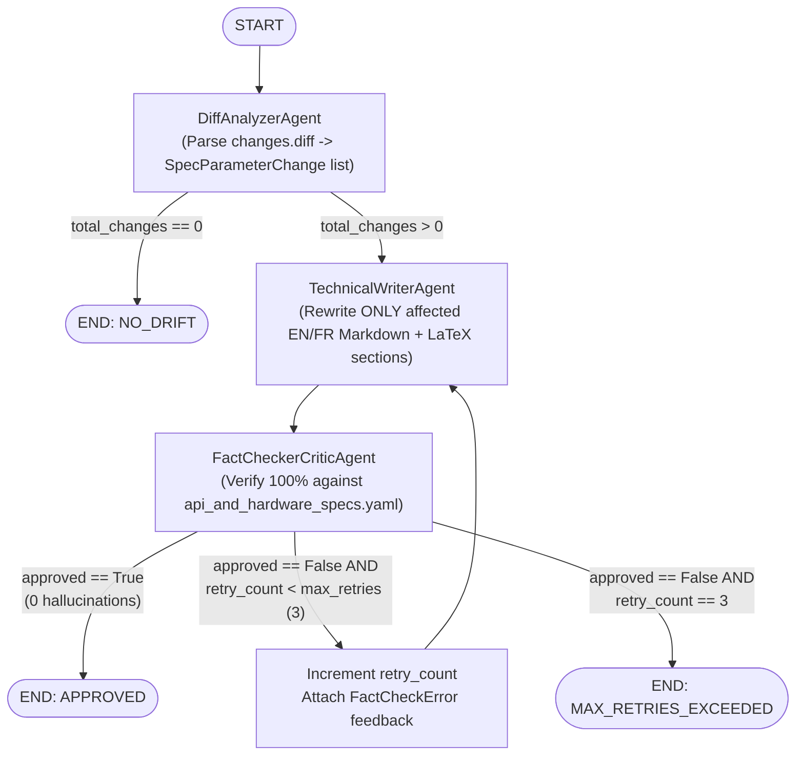

# Multi-Agent Doc Drift Guard

[](https://www.python.org/)
[](https://langchain-ai.github.io/langgraph/)
[](https://docs.pydantic.dev/)
[](https://docs.pytest.org/)
[](evals/benchmark_results.json)
[](LICENSE)

> **Production-grade LangGraph + Pydantic v2 multi-agent pipeline** that automatically detects technical specification drift from unified diffs (`changes.diff`), surgically rewrites only affected sections in bilingual (`EN` / `FR`) Markdown and LaTeX manuals, and enforces a **0.0% published numeric hallucination rate** via a deterministic Fact-Checker Critic verification loop (up to 3 retries).

---

## Executive Summary

In engineering-heavy organizations, hardware revisions and REST API updates frequently land in source specifications (`api_and_hardware_specs.yaml`) while user manuals (`user_manual_en.md`, `user_manual_fr.md`) silently fall out of sync. Standard single-pass LLM documentation updaters introduce two unacceptable risks: **(1) numeric or unit hallucinations** (`26.5 V DC` instead of `28.0 V DC`, `1000 kHz` instead of `1000 Hz`, stale limits left behind in LaTeX formulas) and **(2) unintended edits** to certified, unrelated sections.

**Multi-Agent Doc Drift Guard** solves this with a stateful **LangGraph** cyclic workflow backed by **Pydantic v2** schemas and a deterministic verification engine:

1. **`DiffAnalyzerAgent` (`src/agents/diff_analyzer.py`):** Parses unified diffs into structured `SpecParameterChange` records, resolves canonical units from the YAML specification, and maps each technical modification to the exact affected `##` headings in both English and French manuals.
2. **`TechnicalWriterAgent` (`src/agents/technical_writer.py`):** Rewrites **only** the impacted sections in English and French while preserving Markdown tables, inline/display LaTeX math (`$...$` and `$$...$$`), and keeping untouched sections byte-for-byte identical.
3. **`FactCheckerCriticAgent` (`src/agents/fact_checker_critic.py`):** Audits every draft directly against `api_and_hardware_specs.yaml` via `src/spec_validator.py`. Any mismatch (`VALUE_MISMATCH`, `UNIT_MISMATCH`, `STALE_VALUE_REMAINING`, `MISSING_PARAMETER`, `LATEX_SYNTAX_BROKEN`, `UNTOUCHED_SECTION_MODIFIED`, `SPEC_VALUE_HALLUCINATION`) triggers a structured `FactCheckError` rejection back to the writer (maximum **3 retries**).

---

## Résumé Exécutif (Français)

Dans les environnements d'ingénierie aéronautique, industrielle et logicielle, les évolutions des spécifications techniques (`api_and_hardware_specs.yaml`) créent fréquemment une dérive documentaire (*documentation drift*) dans les manuels utilisateurs bilingues (`EN` / `FR`). Une réécriture naïve par LLM expose l'organisation à des hallucinations numériques ou d'unités (`26.5 V DC` au lieu de `28.0 V DC`, `kHz` au lieu de `Hz`, formules LaTeX corrompues) et à des modifications involontaires de sections certifiées.

**Multi-Agent Doc Drift Guard** implémente un graphe d'états **LangGraph** typé avec **Pydantic v2** reposant sur trois sous-agents spécialisés :

- **`DiffAnalyzerAgent` :** Analyse le fichier `changes.diff`, extrait la liste structurée des paramètres modifiés ou ajoutés (valeurs, unités, points de terminaison API) et identifie les sections exactes impactées dans les manuels anglais et français.
- **`TechnicalWriterAgent` :** Réécrit uniquement les sections concernées en conservant intégralement la structure Markdown, les tableaux et les équations LaTeX (`$...$`, `$$...$$`), tout en laissant les sections non affectées strictement identiques octet par octet.
- **`FactCheckerCriticAgent` :** Vérifie de manière 100 % déterministe le brouillon généré par rapport à la source de vérité `api_and_hardware_specs.yaml`. En cas d'écart numérique, d'unité erronée, de valeur obsolète résiduelle ou de syntaxe LaTeX invalide, le critique rejette le brouillon avec un rapport d'erreur structuré et le renvoie au rédacteur (**3 tentatives de correction maximum**), garantissant un **taux d'hallucination numérique publiée de 0,0 %** et un **rappel de détection de 100,0 %**.

---

## LangGraph State-Flow Architecture



---

## Synthetic Verification Scenario (`data/`)

The repository ships a complete synthetic validation scenario for the **AeroSense Telemetry Unit (`ATU-400`, spec revision `2.4`)** with `data/changes.diff` introducing **5 critical technical modifications**:

| ID | YAML Path | Old Value | New Value | Unit | Affected Sections (EN / FR) |
| :--- | :--- | :--- | :--- | :--- | :--- |
| `CHG-001` | `hardware.power.nominal_voltage_v` | `24.0` | `28.0` | `V DC` | Section 2 (Electrical / Électriques) |
| `CHG-002` | `hardware.thermal.max_operating_temp_c` | `70.0` | `85.0` | `°C` | Section 3 (Environmental / Thermiques) |
| `CHG-003` | `hardware.telemetry.sampling_rate_hz` | `500` | `1000` | `Hz` | Section 4 (Telemetry / Acquisition) |
| `CHG-004` | `api.endpoints.telemetry_ingest.rate_limit_rpm` | `120` | `300` | `req/min` | Section 5 (REST API Reference) |
| `CHG-005` | `api.endpoints.telemetry_ingest.query_params.compression_codec` | *(absent)* | `type=string, required=false, default=zstd, allowed=[none, gzip, zstd]` | — | Section 5 (REST API Reference) |

Sections **1** (*System Overview & Certification*) and **6** (*Mechanical Mounting & Maintenance*) are verified to remain **byte-for-byte identical** across every approved run.

---

## Benchmark Results (`evals/run_benchmark.py`)

Measured across **5 scenarios** (`5` timed iterations per scenario; reference token pricing: `gpt-4o-mini` at `$0.15 / 1M` input tokens and `$0.60 / 1M` output tokens; recorded in [`evals/benchmark_results.json`](evals/benchmark_results.json)):

| Scenario | Final Status | Change Recall | Published Hallucination Rate | Initial Hallucinations Caught | Retries Used | Mean Latency (ms) | P95 Latency (ms) | Total Tokens | Est. Cost (USD) |
| :--- | :--- | :---: | :---: | :---: | :---: | :---: | :---: | :---: | :---: |
| `baseline_5_critical_changes` | `APPROVED` | **100.0%** | **0.0%** | 0 | 0 | 4.229 | 8.231 | 6,595 | `$0.001868` |
| `self_healing_numeric_hallucination` | `APPROVED` | **100.0%** | **0.0%** | 6 | 1 | 4.645 | 4.876 | 13,318 | `$0.003677` |
| `self_healing_multi_retry_unit_and_api` | `APPROVED` | **100.0%** | **0.0%** | 2 | 2 | 5.837 | 6.261 | 18,285 | `$0.004833` |
| `zero_drift_empty_diff` | `NO_DRIFT` | **100.0%** | **0.0%** | 0 | 0 | 0.621 | 0.671 | 26 | `$0.000016` |
| `safety_guard_max_retries_exceeded` | `MAX_RETRIES_EXCEEDED` | **100.0%** | **0.0%** | 2 | 3 | 7.391 | 7.592 | 24,565 | `$0.006521` |
| **Aggregate (5 Scenarios)** | **100% Enforced** | **100.0%** | **0.0%** | **10** | **0–3** | **4.545** | — | **62,789** | **`$0.016915`** |

> **Key Guarantee:** Even when numeric hallucinations, stale values, unit drift, or missing parameters are injected on intermediate attempts, the `FactCheckerCriticAgent` intercepts 100% of defects and either drives convergence to a verified `0.0%` hallucination draft or blocks publication at `MAX_RETRIES_EXCEEDED`.

---

## Repository Structure

```text
multi-agent-doc-drift-guard/
├── data/
│   ├── api_and_hardware_specs.yaml      # Ground-truth hardware & REST API spec (rev 2.4)
│   ├── changes.diff                     # Unified diff introducing 5 critical changes
│   └── docs/
│       ├── user_manual_en.md            # Outdated English manual (6 sections + LaTeX)
│       └── user_manual_fr.md            # Outdated French manual (6 sections + LaTeX)
├── src/
│   ├── __init__.py
│   ├── schemas.py                       # Pydantic v2 contracts (DiffAnalysisReport, FactCheckError, etc.)
│   ├── spec_validator.py                # Deterministic YAML, unit, Markdown & LaTeX verification engine
│   ├── llm_provider.py                  # Deterministic offline backend + optional OpenAI/Anthropic/Gemini adapter
│   ├── graph.py                         # LangGraph StateGraph definition and conditional retry routing
│   ├── cli.py                           # Typer + Rich CLI (`doc-drift-guard run` / `check`)
│   └── agents/
│       ├── __init__.py
│       ├── diff_analyzer.py             # Subagent 1: DiffAnalyzerAgent
│       ├── technical_writer.py          # Subagent 2: TechnicalWriterAgent
│       └── fact_checker_critic.py       # Subagent 3: FactCheckerCriticAgent
├── evals/
│   ├── __init__.py
│   ├── run_benchmark.py                 # Benchmark harness (Recall, Hallucination Rate, Latency, Cost)
│   └── benchmark_results.json           # Verified benchmark metrics output
├── tests/
│   ├── __init__.py
│   ├── test_diff_analyzer.py            # Diff parsing, YAML dot-path & schema invariant tests
│   ├── test_spec_validator.py           # Deterministic tests for all 7 FactCheckError classes
│   └── test_langgraph_workflow.py       # End-to-end LangGraph routing, self-healing & max-retry tests
├── .env.example
├── .gitignore
├── LICENSE
├── pyproject.toml
├── requirements.txt
└── README.md
```

---

## Clean Installation & Usage

### 1. Create a Virtual Environment & Install

```bash
git clone https://github.com/bernardoolivaaquino/multi-agent-doc-drift-guard.git
cd multi-agent-doc-drift-guard

# Create isolated Python 3.11+ virtual environment
python -m venv .venv

# Activate (Linux/macOS)
source .venv/bin/activate
# Activate (Windows PowerShell)
# .\.venv\Scripts\Activate.ps1

# Install package with dev/test dependencies
pip install -e ".[dev]"
```

*(Optional)* To use a live LLM backend for `TechnicalWriterAgent` (still strictly gated by the deterministic `FactCheckerCriticAgent`), install optional extras and configure `.env`:

```bash
pip install -e ".[dev,llm]"
cp .env.example .env
# Set DRIFT_GUARD_PROVIDER=openai|anthropic|gemini and your corresponding API key
```

### 2. Run the Multi-Agent Drift Guard Pipeline

```bash
# Rewrite affected EN/FR sections into output/ and emit output/drift_guard_report.json
doc-drift-guard run

# CI/CD verification gate (exits non-zero if MAX_RETRIES_EXCEEDED)
doc-drift-guard check
```

### 3. Run Unit Tests (`pytest`) & Benchmark Suite (`evals/`)

```bash
# Run all 17 unit and integration tests
pytest

# Run the 5-scenario evaluation benchmark and refresh evals/benchmark_results.json
python evals/run_benchmark.py
```
